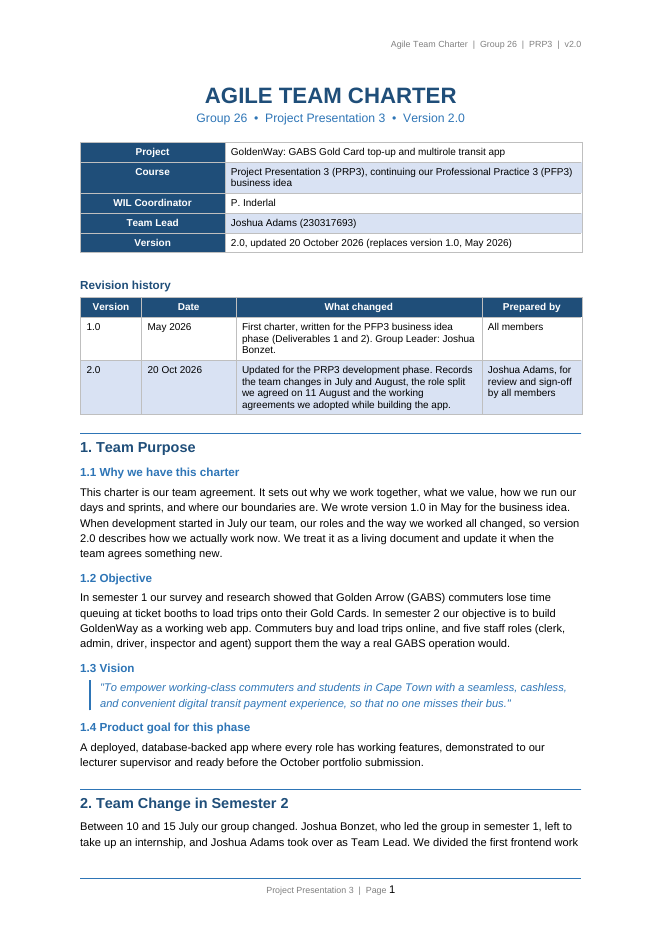
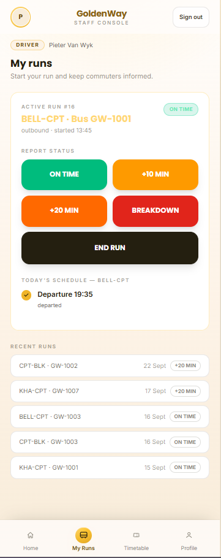
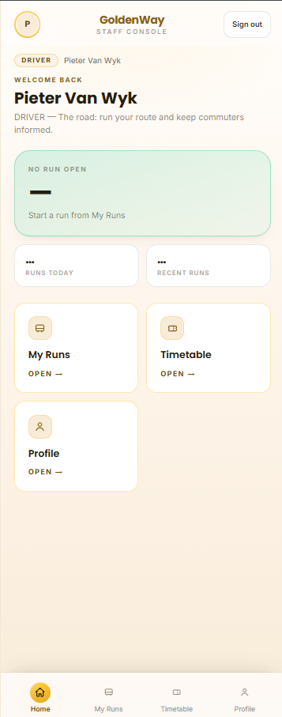
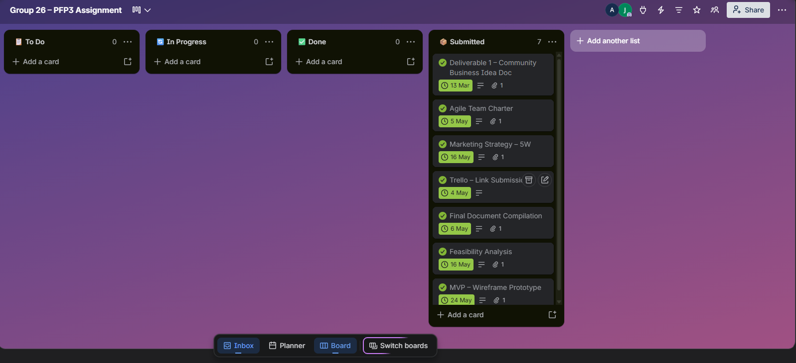
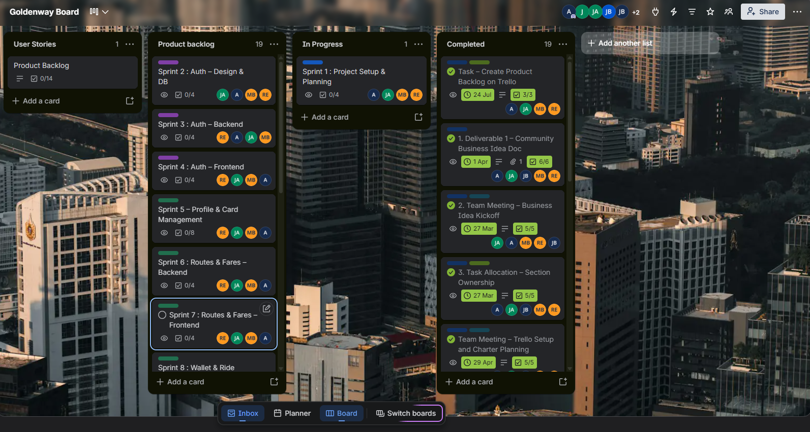
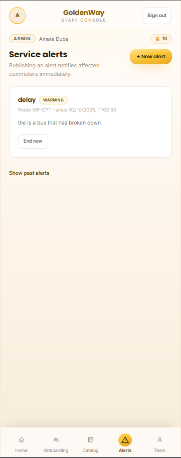

<span class="eyebrow">PRP370S · Project Presentation 3 · Assessment 2</span>

# Agile eWIL: <em>driving</em> GoldenWay

GoldenWay is a web app our team (Group 26) built so Golden Arrow commuters can buy and load Gold Card trips online, with tools for five staff roles. I was the **developer on the Driver role**, and in July I was **in charge of our first Trello board and product backlog**. This page follows the route through the five Agile artefacts. Each stop shows the evidence first, then my reflection on it.
{: .lead}

<div class="facts">
  <div class="fact"><b>3</b><span>Driver user stories delivered</span></div>
  <div class="fact"><b>1,790</b><span>lines of code added across 15 files</span></div>
  <div class="fact"><b>6</b><span>database migrations I wrote</span></div>
  <div class="fact"><b>4</b><span>pull request merges of my branch</span></div>
  <div class="fact"><b>1</b><span>security hole found and fixed</span></div>
</div>

<div class="actions">
  <a class="btn" href="https://trello.com/b/fMkfGDiw/goldenway-board">Open our Trello board</a>
  <a class="btn btn--ghost" href="https://github.com/aidan-g-barends/GoldenWayApp">GoldenWay repository</a>
  <a class="btn btn--ghost" href="https://goldenwayapp.vercel.app/">Live app</a>
</div>

<nav class="route" aria-label="Artefacts on this page">
  <div class="route__label"><span>Route: charter to logbook</span><span>5 stops</span></div>
  <div class="route__line">
    <a href="#charter"><i></i>Team Charter</a>
    <a href="#stories"><i></i>User Stories</a>
    <a href="#product-backlog"><i></i>Product Backlog</a>
    <a href="#sprint-backlog"><i></i>Sprint Backlog</a>
    <a href="#logbook"><i></i>Logbook</a>
  </div>
</nav>

<!-- =================================================================== -->
<section class="stop" id="charter" markdown="1">

<div class="stop__head">
  <span class="stop__num">1</span>
  <div>
    <h2>Agile Team Charter</h2>
    <p>Our team agreement: purpose, values, working agreements and boundaries. Version 1.0 was written in May 2026 and updated to version 2.0 on 20 October 2026 after the team changed.</p>
  </div>
</div>

<div data-tabs markdown="1">
<div class="tabs" role="tablist">
  <button type="button" role="tab" aria-selected="true" aria-controls="charter-ev">Evidence</button>
  <button type="button" role="tab" aria-selected="false" aria-controls="charter-re">Reflection</button>
</div>

<div class="panel" id="charter-ev" role="tabpanel" markdown="1">

An Agile team charter is a living, co-created agreement that sets out a team's purpose, values, working agreements and boundaries (CPUT, 2026). Ours is a team artefact (Group 26, 2026). <span class="tag team">Team artefact</span>

<div class="cols" markdown="1">
<div markdown="1">

#### Roles and ownership

| Member | Role |
|---|---|
| Joshua Adams | Team Lead · Commuter and Clerk |
| Matthew Barron | Admin |
| **Aidan Barends (me)** | **Driver: starting runs, delay reporting, run timelines, on-time tracking** |
| Joshua Bird | Inspector |
| Raul Everts | Agent |

</div>
<div markdown="1">

#### Working agreements

- One-week sprints: planning on Tuesday, retro at the end of the week
- Stand-ups on class days: done, next, blockers
- One branch per member (mine: `AB-230255639`), no direct pushes to `main`
- Business rules live in database functions; **every table has row-level security**
- Disagreements: talk to the person first, then stand-up, then Team Lead, then lecturer

</div>
</div>

#### What the charter covers

| Element | What our charter says |
|---|---|
| Purpose | Stop commuters losing time in ticket queues by letting them load Gold Card trips online |
| Values | Ubuntu, respect, transparency, accountability, ethical capability, continuous improvement |
| Decisions | Role owners decide inside their role; cross-role decisions by consensus at planning; Team Lead breaks ties |
| Boundaries | Simulated payments only, no full card numbers, no NFC hardware, feature freeze from 20 October |
| Definition of Done | Works on the real database, lint and tests pass, PR reviewed and merged, checked on mobile, Trello card and logbook updated |

#### Where the charter shows up in my own work

| Charter rule | My evidence |
|---|---|
| Own branch, named by convention | `AB-230255639` merged into `main` through pull requests on 17 Sep, 24 Sep and 1 Oct 2026 |
| Every table has RLS; ethical capability | I found and fixed a security hole in the driver's `vehicle_runs` table ([commit 488e060](https://github.com/aidan-g-barends/GoldenWayApp/commit/488e060), 16 Sep 2026) |
| Ubuntu: help before moving on | I helped a teammate harden the inspector table ([commit d5d9029](https://github.com/aidan-g-barends/GoldenWayApp/commit/d5d9029), 18 Sep 2026) |

<div class="shots">
  <figure class="shot"><figcaption>Agile Team Charter v2.0, first page</figcaption></figure>
</div>

<div class="actions">
  <a class="btn" href="assets/docs/Agile_Team_Charter_v2.0.pdf">Charter v2.0 (PDF)</a>
</div>

</div>

<div class="panel" id="charter-re" role="tabpanel" hidden markdown="1">

### What the charter meant in practice

Two of the charter's rules ended up shaping my actual code on the Driver role.

The first was **"every table has row-level security."** While working on driver runs, I found that the security rule on our `vehicle_runs` table only checked that a run belonged to the logged-in user. It never checked that the user was actually a driver. That meant a clerk, agent or inspector could create a fake run and mark it delayed, which would send a false service alert to commuters. I confirmed it on the live project with a clerk demo account, fixed it so only drivers (or admins) can create runs, and checked it was blocked. Having RLS switched on was not enough. The rule itself had to be tested from the point of view of the wrong user.

The second was **Ubuntu: if someone is stuck, help them before moving on to your own next task**. In the week of the demo a teammate needed help setting up his inspector table, so I helped, even though my own driver work was already behind. The charter made that the expected thing to do, but nothing in our planning made room for it, which is part of why my sprint ran over (stop 4).

**What I take forward:** I'll use a charter as a checklist for my own work, for example by testing every security rule I write against a user who should be blocked. I'd also want the next charter to say how helping a teammate gets planned, not just that we should do it.

</div>
</div>
</section>

<!-- =================================================================== -->
<section class="stop" id="stories" markdown="1">

<div class="stop__head">
  <span class="stop__num">2</span>
  <div>
    <h2>User Stories and Tasks</h2>
    <p>The three Driver stories I owned, written from the driver's point of view, each broken into tasks I can link to a commit.</p>
  </div>
</div>

<div data-tabs markdown="1">
<div class="tabs" role="tablist">
  <button type="button" role="tab" aria-selected="true" aria-controls="stories-ev">Evidence</button>
  <button type="button" role="tab" aria-selected="false" aria-controls="stories-re">Reflection</button>
</div>

<div class="panel" id="stories-ev" role="tabpanel" markdown="1">

A user story describes a feature from the user's point of view in the form *As a [user], I want [feature], so that [benefit]* (Cohn, 2004). These stories come from the team's multirole product backlog, added after we split the app by role on 11 August ([backlog card on Trello](https://trello.com/c/h903LTtg/1-product-backlog-multirole-staff-roles)).

I wrote the acceptance criteria for this page from how each feature was built and tested, so they are a **reconstruction**, not text copied from the original cards.
{: .note}

<div class="story" markdown="1">
<div class="story__top"><span>DR-1 · Start a run and report delays</span><span><span class="tag must">Must</span> <span class="tag done">Done</span></span></div>

> As a **driver**, I want to **start my run and report delays**, so that **commuters know where their bus is**.

**Acceptance criteria**

- Only a user with the Driver role can start a run or report its status
- A driver cannot open a second run while one is still open, and gets a clear message instead of an error
- A delay report with a note shows up as a service alert that admin and commuters can see
- The run timeline shows each status change in order

| Task | Commit |
|---|---|
| Delay note composer and run timeline on the Runs screen | [bc4b9e6](https://github.com/aidan-g-barends/GoldenWayApp/commit/bc4b9e6) |
| Restrict runs to the Driver role in RLS, cap note length and delay minutes, friendly double-tap message | [488e060](https://github.com/aidan-g-barends/GoldenWayApp/commit/488e060) |
| Admin alerts screen so driver delay reports reach admin, closing the driver to commuter alerts loop | [7878984](https://github.com/aidan-g-barends/GoldenWayApp/commit/7878984) |

</div>

<div class="story" markdown="1">
<div class="story__top"><span>DR-2 · Pre-trip note and on-time tracking</span><span><span class="tag should">Should</span> <span class="tag done">Done</span></span></div>

> As a **driver**, I want to **add a pre-trip note and track whether my run is on time**, so that **delays are recorded accurately**.

**Acceptance criteria**

- Starting a run accepts an optional pre-trip note (bus condition, odometer)
- Completing a run keeps the delay that was reported, so the on-time figure stays accurate
- The staff home screen shows a dashboard strip with the driver's figures

| Task | Commit |
|---|---|
| Add the pre-trip note to `start_run` and fix completed runs wiping their delay | [66efd9b](https://github.com/aidan-g-barends/GoldenWayApp/commit/66efd9b) |
| Dashboard strip on the staff landing screen | [f8855ce](https://github.com/aidan-g-barends/GoldenWayApp/commit/f8855ce) |

</div>

<div class="story" markdown="1">
<div class="story__top"><span>DR-3 · Choose the run direction</span><span><span class="tag could">Could</span> <span class="tag done">Done</span></span></div>

> As a **driver**, I want to **choose the direction of my run**, so that **the timeline matches the way I am driving the route**.

**Acceptance criteria**

- The driver picks a direction before starting a run
- The screen shows a loading state while the run is being saved

| Task | Commit |
|---|---|
| Direction picker, loading state and composer fixes | [98147cb](https://github.com/aidan-g-barends/GoldenWayApp/commit/98147cb) |

</div>

<div class="shots">
  <figure class="shot"><figcaption>Driver "My runs" screen: active run, status buttons (on time, +10, +20, breakdown, end run), today's schedule and recent runs</figcaption></figure>
  <figure class="shot"><figcaption>Driver landing page: run status card, dashboard strip and shortcuts (DR-2)</figcaption></figure>
</div>

The repository's history starts on 16 September 2026 with a combined import of the app, so the tables only link commits recorded under my name.
{: .muted}

</div>

<div class="panel" id="stories-re" role="tabpanel" hidden markdown="1">

### What I learned about stories and tasks

The part of a user story I underestimated was the **"so that"**. DR-1 says *so that commuters know where their bus is*. My first reading was "build a button that starts a run." But the story is not finished when the driver presses the button. It is finished when a commuter can see the result. That is why my tasks spread beyond the Driver screen into the database rules and an admin alerts screen, and it is why connecting the driver side to admin and commuters was the hardest part of my work.

Breaking the stories into tasks helped in two ways. Each task became a commit I could test on its own, and the priorities told me what to do first. DR-1 was a Must, so I made it secure before I added the Could-level direction picker.

Writing acceptance criteria for this page showed me what was missing during the project: we did not have clear "done" checks for each story before I started coding. If I had written *only a driver can create a run* up front, I would have tested for the security hole on day one instead of finding it later.

**What I take forward:** write acceptance criteria before coding, and include the users on the other end of the story (here, admin and commuters) in the criteria, not just the user named in it.

</div>
</div>
</section>

<!-- =================================================================== -->
<section class="stop" id="product-backlog" markdown="1">

<div class="stop__head">
  <span class="stop__num">3</span>
  <div>
    <h2>Product Backlog</h2>
    <p>Everything GoldenWay needed, in priority order. The first version lived on the board I managed in July; it was rebuilt around roles in August.</p>
  </div>
</div>

<div data-tabs markdown="1">
<div class="tabs" role="tablist">
  <button type="button" role="tab" aria-selected="true" aria-controls="pb-ev">Evidence</button>
  <button type="button" role="tab" aria-selected="false" aria-controls="pb-re">Reflection</button>
</div>

<div class="panel" id="pb-ev" role="tabpanel" markdown="1">

The product backlog is the ordered list of everything the product needs. A sprint backlog is the small slice of it chosen for one sprint (Schwaber and Sutherland, 2020).

<div class="cols" markdown="1">
<div markdown="1">

#### Version 1: the backlog I managed (July 2026)

In July I was in charge of our Trello board. Building the backlog was a team task, so the cards list every member, me included.

| Trello card | Date | Status |
|---|---|---|
| [Team Meeting: Trello Board Layout](https://trello.com/c/3hL0apr3/46-team-meeting-trello-board-layout) | 14 Jul 2026 | Completed |
| [Task: Create Product Backlog on Trello](https://trello.com/c/MmumlezL/45-task-create-product-backlog-on-trello) | 24 Jul 2026 | Completed |
| 19 roadmap cards in the *Product backlog* list | July 2026 | Planned |

The 19 blocks, ordered with MoSCoW priorities: project setup; auth (design, backend, frontend); profile and card management; routes and fares; wallet and ride balance; ticket purchase; digital ticket / QR code; top-up and ride history; notifications; testing; stretch features (tap-to-pay, auto top-up, ratings); final QA and submission.

</div>
<div markdown="1">

#### How the backlog evolved

<ul class="timeline">
  <li><b>Mar to May 2026 · PFP3</b>First board, <em>Group 26: PFP3 Assignment</em>: the business-idea deliverables, charter v1.0, feasibility analysis and the MVP wireframe, all submitted.</li>
  <li><b>14 to 24 Jul 2026</b>New main board, the <a href="https://trello.com/b/fMkfGDiw/goldenway-board">Goldenway Board</a>: layout agreed and product backlog of 19 roadmap cards created. This is the board we submitted.</li>
  <li><b>11 Aug 2026</b>Team makes GoldenWay a multirole app. Our Team Lead takes over Trello and manages the role-based work on an <a href="https://trello.com/b/xyZiSfZl/goldenway-board-updated">updated board</a>, with a backlog card of stories for each staff role.</li>
  <li><b>Aug to Sep 2026</b>I own the Driver slice of the new backlog (below).</li>
  <li><b>20 Oct 2026</b>Feature freeze: only bug fixes and documentation after this.</li>
</ul>

#### The Driver slice I owned

| ID | Story | Priority | Status |
|---|---|---|---|
| DR-1 | Start a run and report delays | <span class="tag must">Must</span> | Done |
| DR-2 | Pre-trip note and on-time tracking | <span class="tag should">Should</span> | Done |
| DR-3 | Choose the run direction | <span class="tag could">Could</span> | Done |

</div>
</div>

<div class="shots">
  <figure class="shot"><figcaption>First board (PFP3, semester 1): all seven deliverables submitted</figcaption></figure>
  <figure class="shot"><figcaption>Goldenway Board, our main and submitted board: the Product backlog list with the 19 roadmap cards. "A" is me.</figcaption></figure>
  <figure class="shot"><figcaption>Updated board, managed by the Team Lead</figcaption></figure>
</div>

</div>

<div class="panel" id="pb-re" role="tabpanel" hidden markdown="1">

### What I learned about managing a backlog

Building the first backlog as a team, and then looking after it on the board, taught me how much planning goes into a product before any code is written. Laying out 19 blocks forced us to think about order: auth before profiles, wallets before ticket purchases, testing near the end.

Looking back, version 1 had two weaknesses. First, we named the cards *Sprint 1* to *Sprint 19* but kept them in the *Product backlog* list. That mixed up two different things. A product backlog is a prioritised list of **what** the product needs. A sprint is a **time box** in which the team picks some of those items. Naming backlog items as sprints made it look as if we had already decided when each would be done. Second, the plan assumed a commuter-only app and 19 sprints. In reality we had about ten one-week sprints, a change of Team Lead in July and a switch to five roles in August.

The backlog had to change, and it did. When the Team Lead took over the board and rebuilt it around roles, I saw that a product backlog is not a plan you defend. It is a list you keep reordering as you learn. That is the point of Agile responding to change rather than following a plan (Beck et al., 2001).

**What I take forward:** keep the product backlog as user stories with priorities, keep sprints as a separate time box, and expect the backlog to be rewritten when the product changes.

</div>
</div>
</section>

<!-- =================================================================== -->
<section class="stop" id="sprint-backlog" markdown="1">

<div class="stop__head">
  <span class="stop__num">4</span>
  <div>
    <h2>Sprint Backlog</h2>
    <p>What I committed to in my main delivery sprint, the week of the 17 September integration demo, and what actually happened.</p>
  </div>
</div>

<div data-tabs markdown="1">
<div class="tabs" role="tablist">
  <button type="button" role="tab" aria-selected="true" aria-controls="sb-ev">Evidence</button>
  <button type="button" role="tab" aria-selected="false" aria-controls="sb-re">Reflection</button>
</div>

<div class="panel" id="sb-ev" role="tabpanel" markdown="1">

**Product backlog vs sprint backlog.** The product backlog (stop 3) is everything the product could need, in priority order. The sprint backlog is the few items the team commits to for one sprint, plus the tasks to deliver them. Our sprints were one week long, planned on Tuesday and closed with a retrospective (Group 26, 2026).
{: .note}

**Team sprint goal:** demonstrate the integrated app, frontend and backend working against the live database, at the 17 September demo.<br>
**My sprint goal:** get the Driver role working securely end to end, from the driver's screen to admin and commuters.

| Item | Task | Date | Status | Commit |
|---|---|---|---|---|
| DR-2 | Pre-trip note on start run, on-time fix | 16 Sep | <span class="tag done">Done</span> | [66efd9b](https://github.com/aidan-g-barends/GoldenWayApp/commit/66efd9b) |
| DR-1 | Delay note composer and run timeline | 16 Sep | <span class="tag done">Done</span> | [bc4b9e6](https://github.com/aidan-g-barends/GoldenWayApp/commit/bc4b9e6) |
| DR-2 | Dashboard strip on staff landing | 16 Sep | <span class="tag done">Done</span> | [f8855ce](https://github.com/aidan-g-barends/GoldenWayApp/commit/f8855ce) |
| DR-1 | Fix RLS privilege escalation on runs, input limits | 16 Sep | <span class="tag done">Done</span> | [488e060](https://github.com/aidan-g-barends/GoldenWayApp/commit/488e060) |
| DR-3 | Direction picker and loading state | 16 Sep | <span class="tag done">Done</span> | [98147cb](https://github.com/aidan-g-barends/GoldenWayApp/commit/98147cb) |
| Bug | Staff login sent to the wrong home screen | 16 Sep | <span class="tag done">Done</span> | [38f43d0](https://github.com/aidan-g-barends/GoldenWayApp/commit/38f43d0) |
| Staff | Staff profile edit and account deactivation | 17 Sep | <span class="tag done">Done</span> | [6b0ec07](https://github.com/aidan-g-barends/GoldenWayApp/commit/6b0ec07) |
| Help | Inspector table hardening and inspection history (helping a teammate) | 18 Sep | <span class="tag done">Done</span> | [d5d9029](https://github.com/aidan-g-barends/GoldenWayApp/commit/d5d9029) |
| DR-1 | Admin alerts screen (driver to commuter alerts loop) | 18 Sep | <span class="tag done">Done</span> | [7878984](https://github.com/aidan-g-barends/GoldenWayApp/commit/7878984) |

**Outcome:** my branch `AB-230255639` was merged into `main` through pull requests on 17 September, demo day. Later merges followed on 24 September and 1 October, before deployment and the 20 October feature freeze.

#### The security fix from this sprint

Before the fix, the rule only checked `driver_id = auth.uid()`. Now the caller must also hold the Driver role:

```sql
create policy vehicle_runs_insert on public.vehicle_runs
  for insert with check (
    (driver_id = auth.uid() and public.is_staff('DRIVER'))
    or public.is_staff('ADMIN')
  );
```

<span class="muted">From migration <code>0012a_driver_hardening.sql</code>, commit <a href="https://github.com/aidan-g-barends/GoldenWayApp/commit/488e060">488e060</a>.</span>

<div class="shots">
  <figure class="shot"><figcaption>Admin alerts screen receiving a driver delay report</figcaption></figure>
</div>

</div>

<div class="panel" id="sb-re" role="tabpanel" hidden markdown="1">

### What I learned about planning a sprint

This sprint did not go to plan. My driver work took longer than expected, and during the same week I had to help a teammate set up his inspector table. The sprint table shows it: three of the nine items (the login bug, the staff profile and the inspector help) were not Driver stories at all. Most of my commits landed between 16 and 18 September, right around the 17 September demo.

Two lessons came out of that. First, a sprint backlog has to leave room for things you cannot see coming. Helping a teammate was the right call under our Ubuntu value, but because nobody planned for it, it squeezed my own work towards the deadline. Second, I underestimated the cross-role work. The driver screen was one task, but getting a delay to show up for admin and commuters touched parts of the app that other people owned.

What worked was the time box itself. A one-week sprint with a fixed demo date forced me to decide what "done" meant for the Driver role, and to finish it instead of polishing one screen forever.

**What I take forward:** break cross-role tasks out as their own sprint items, estimate them higher, keep some capacity free for helping others, and spread commits through the sprint instead of finishing near the deadline.

</div>
</div>
</section>

<!-- =================================================================== -->
<section class="stop" id="logbook" markdown="1">

<div class="stop__head">
  <span class="stop__num">5</span>
  <div>
    <h2>Agile Logbook</h2>
    <p>My week-by-week record of the project, in the stand-up shape our charter uses: what was done, my part, what came next and what blocked me.</p>
  </div>
</div>

<div data-tabs markdown="1">
<div class="tabs" role="tablist">
  <button type="button" role="tab" aria-selected="true" aria-controls="log-ev">Evidence</button>
  <button type="button" role="tab" aria-selected="false" aria-controls="log-re">Reflection</button>
</div>

<div class="panel" id="log-ev" role="tabpanel" markdown="1">

An Agile logbook records stand-ups, sprint plans and retrospectives so a team can track progress and blockers over time. I compiled this record from Trello cards, commits and merges in the GoldenWay repository, and milestones in our charter. Each week lists its evidence.

<details markdown="1" open>
<summary><code>Week 1 · 13 to 17 Jul</code> Board layout and the pitch</summary>

- **Done:** Trello board layout agreed in a team meeting (14 Jul); pitch presented to the lecturer (17 Jul). Our previous Team Lead left for an internship and Joshua Adams took over.
- **My part:** in charge of the Trello board.
- **Next:** build the product backlog on Trello.
- **Evidence:** Trello cards *Team Meeting: Trello Board Layout* and *Presentation Day*; Charter section 2.
</details>

<details markdown="1">
<summary><code>Week 2 · 20 to 24 Jul</code> Product backlog on Trello</summary>

- **Done:** product backlog created with 19 roadmap cards (completed 24 Jul); business presentation submission updated (22 Jul); backlog reworked after lecturer feedback.
- **My part:** looked after the board while the team built the backlog.
- **Next:** Figma prototype.
- **Evidence:** Trello cards *Task: Create Product Backlog on Trello* and *Update Business Presentation Submission*; Charter milestones.
</details>

<details markdown="1">
<summary><code>Week 3 · 27 to 31 Jul</code> Figma prototype</summary>

- **Done (team):** Figma prototype presented to the lecturer (29 Jul).
- **Next:** set up the React project.
- **Evidence:** Charter milestones.
</details>

<details markdown="1">
<summary><code>Week 4 · 3 to 7 Aug</code> React set-up</summary>

- **Done (team):** React project set up (4 Aug).
- **Evidence:** Charter milestones; Trello *Sprint 1: Project Setup and Planning* card moved to In Progress.
</details>

<details markdown="1">
<summary><code>Week 5 · 11 to 14 Aug</code> Multirole decision: I take the Driver role</summary>

- **Done:** team agreed to make GoldenWay a multirole app and designed the database schema (11 Aug).
- **My part:** assigned the Driver role: starting runs, delay reporting, run timelines and on-time tracking. The Team Lead took over running the Trello board from here.
- **Next:** get the Driver role working against the real database.
- **Evidence:** Charter section 3 and milestones.
</details>

<details markdown="1">
<summary><code>Week 6 · 18 to 21 Aug</code> Every role on the real database</summary>

- **Done:** team milestone reached on 21 Aug: every role, Driver included, had database-backed features instead of mock data.
- **Next:** integration demo planned for 17 Sep.
- **Evidence:** Charter goal 2 and milestones.
</details>

<details markdown="1" open>
<summary><code>Week 7 · 15 to 18 Sep</code> Driver build, security fix and the demo</summary>

- **Done (16 Sep):** pre-trip note and on-time fix; delay note composer and run timeline; dashboard strip; direction picker; staff login routing fix.
- **Blocker found (16 Sep):** the `vehicle_runs` security rule let any staff member create a fake run and fire a false alert to commuters. Confirmed with a clerk demo account, fixed and re-checked the same day.
- **Done (17 Sep):** staff profile edit and account deactivation; my branch merged into `main` through pull requests #1 and #2 on demo day.
- **Done (18 Sep):** helped a teammate harden the inspector table and build inspection history; built the admin alerts screen so driver delays reach admin.
- **Blocker:** my driver work took longer than planned, and getting it to communicate with the admin and commuter sides was the hardest part. The inspector help came on top of it.
- **Evidence:** commits 66efd9b, bc4b9e6, f8855ce, 488e060, 98147cb, 38f43d0, 6b0ec07, d5d9029, 7878984; migration `0012a_driver_hardening.sql`.
</details>

<details markdown="1">
<summary><code>Week 8 · 22 to 25 Sep</code> Merging my work</summary>

- **Done:** my work merged again through pull request #8 (24 Sep). Team added email verification, card linking, wallet and password reset.
- **Evidence:** merge commit for pull request #8; Charter milestones.
</details>

<details markdown="1">
<summary><code>Week 9 · 28 Sep to 2 Oct</code> Deployment preparation</summary>

- **Done:** branch `AB-230255639` merged into `main` through pull request #12 (1 Oct) as the team prepared to deploy.
- **Evidence:** merge commits in the repository; Charter milestones.
</details>

<details markdown="1">
<summary><code>Week 10 · 19 to 20 Oct</code> Feature freeze</summary>

- **Done (team):** code review fixes, feature freeze declared, charter updated to v2.0.
- **Next:** individual portfolios due 27 Oct.
- **Evidence:** Charter revision history and milestones.
</details>

#### Retrospective: my Week 7 sprint

| Went well | To improve | Action |
|---|---|---|
| All three Driver stories done and merged by demo day; security hole found and fixed before release | Driver work took longer than planned; most commits landed close to the demo | Split cross-role tasks into their own items and estimate them higher |
| Helped a teammate finish the inspector table | Unplanned help was not in the sprint plan | Keep spare capacity in every sprint |
| Commits record what changed | Some commit messages, like "pudate", say nothing | Write clear commit messages and log progress the same day |

</div>

<div class="panel" id="log-re" role="tabpanel" hidden markdown="1">

### What tracking progress taught me

Looking back over the logbook, the weeks are not equal. Weeks 1 to 6 are mostly team milestones, and almost all of my own development work sits in Week 7. That pattern is useful: it shows my effort was concentrated around the demo rather than spread across the sprints, which is exactly what made Week 7 run over. A logbook makes that visible in a way that memory does not.

Tracking also shows the difference between **what** happened and **why**. Git and Trello record what I did and when, but the blocker in Week 7, that the driver side took longer because it had to talk to the admin and commuter sides, only shows up because I wrote it down. That is the kind of information a stand-up is meant to surface early, so the team can adjust before the deadline instead of after it.

My commit messages taught me the same lesson. *"fix RLS privilege escalation on vehicle runs"* explains itself months later. *"pudate"* on 18 September tells nobody anything, and I had to open the files to see that it was the inspector work. Clear commit messages are a logbook too.

This connects back to the charter's transparency value: blockers come up at stand-up and the board shows the real state of the work. When progress and blockers are written down as they happen, the team can see a problem coming and help before the deadline instead of after it.

**What I take forward:** log progress the same day in a short done, next, blocked format, spread my work across the sprint instead of bunching it near the demo, and write commit messages someone else can understand.

</div>
</div>
</section>

<!-- =================================================================== -->
<section class="stop" id="connect" markdown="1">

<h2 class="bar">What I take into the workplace</h2>

The charter set the rules I worked under, the product backlog gave me the Driver stories, and those stories became my tasks in the September sprint. The logbook shows where that sprint ran over.

The main thing I'm taking with me: test my own work against the people it affects (the clerk who shouldn't be able to create a run, the commuter who needs to see the delay), and plan for the work that sits between roles, because that is where my estimates were wrong.

</section>

<section class="stop refs" id="references" markdown="1">

<h2 class="bar">References</h2>

Beck, K. et al. (2001) *Manifesto for Agile Software Development*. Available at: [https://agilemanifesto.org/](https://agilemanifesto.org/) (Accessed: 26 October 2026).

Cape Peninsula University of Technology (CPUT) (2026) *PRP370S Assessment 2: Portfolio of Evidence Brief*. Cape Town: CPUT.

Cohn, M. (2004) *User Stories Applied: For Agile Software Development*. Boston: Addison-Wesley.

Group 26 (2026) *Agile Team Charter, Version 2.0*. Unpublished team document, Cape Peninsula University of Technology.

Schwaber, K. and Sutherland, J. (2020) *The Scrum Guide*. Available at: [https://scrumguides.org/scrum-guide.html](https://scrumguides.org/scrum-guide.html) (Accessed: 26 October 2026).

</section>
